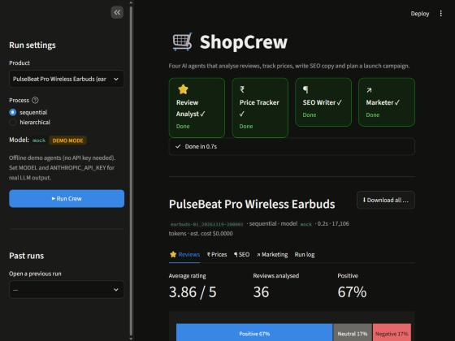
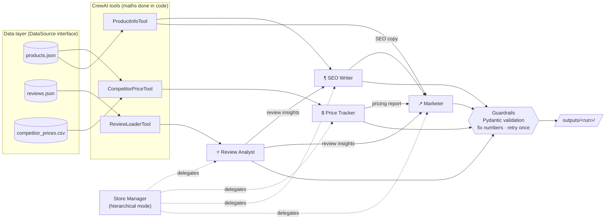
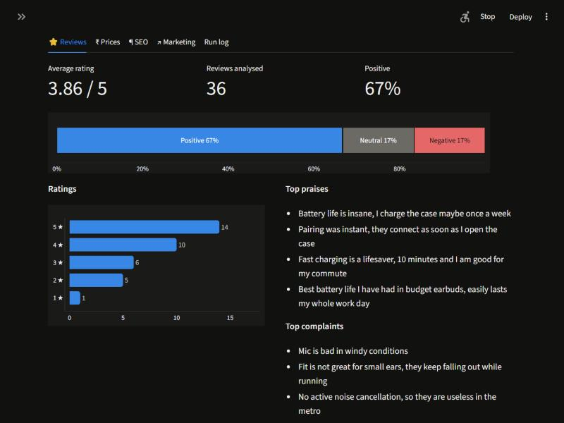
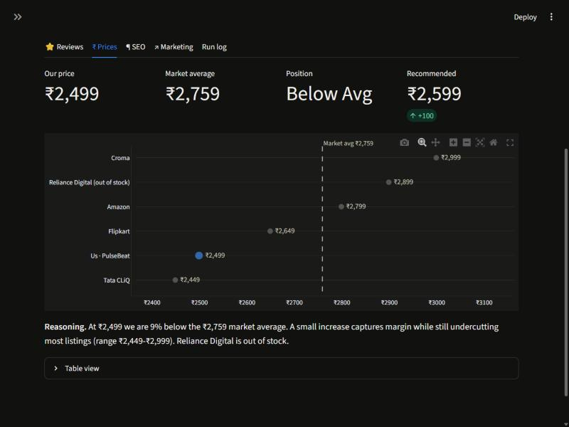
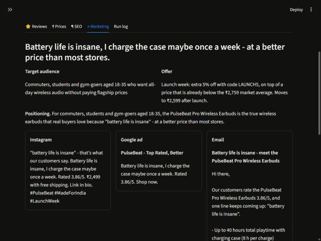

# ShopCrew 🛒

**A team of four AI agents that runs the boring-but-important work of an online store,** built with [CrewAI](https://docs.crewai.com).

A Review Analyst, a Price Tracker and an SEO Writer each do one job, and a Marketer turns everything they found into a launch campaign. The agents **collaborate**: if reviews praise battery life and we're priced 9% below competitors, the campaign leads with *"longest battery life at a better price"*.



| Agent | Job | Output |
|---|---|---|
| ⭐ **Review Analyst** | Sentiment, top praises and complaints, customers' own words | `review_insights.json` |
| $ **Price Tracker** | Compares our price with competitors and recommends a price | `pricing_report.json` |
| ¶ **SEO Writer** | Title, meta, bullets, description and keywords built from real customer language | `seo_copy.md` |
| ↗ **Marketer** | Audience, positioning, offer, Instagram/Google/email copy, 7-day schedule | `campaign_plan.md` |

---

## 🛍️ Northcart: the store the crew works for

ShopCrew now runs inside **Northcart**, a complete e-commerce website (FastAPI + Jinja + SQLite) with a customer storefront and a seller admin panel. The crew analyses the store's **own** reviews and competitor prices, and one click applies its SEO copy, recommended price or "Customers say" summary to the live product page. All AI runs **locally on Ollama** (`qwen3.5:4b`) by default.

```bash
ollama pull qwen3.5:4b          # once; MODEL=ollama/qwen3.5:4b in .env
uv sync
uv run python -m northcart         # http://127.0.0.1:8000 (creates + seeds store.db on first start)
uv run python -m northcart.seed --reset   # optional: rebuild the demo data
```

Demo sign-ins (local test values from `.env.example`): customer `customer@northcart.test` and admin `admin@northcart.test`. The admin panel is at `/admin`.

| Storefront | Seller admin (`/admin`) |
|---|---|
| Home with hero, category tiles, deal-of-the-day shelf with countdown, featured, best sellers, recently viewed | Dashboard: revenue and order KPIs vs previous period, revenue chart, status donut, category and payment split, low stock |
| Search with autocomplete, filters (category, brand, price, rating, discount, stock), sort, pagination | Orders: status tabs, filters, bulk actions, CSV export, lifecycle with allowed transitions only, carrier + tracking number, invoice with state sales tax + packing slip |
| Product page: gallery with zoom, list price/discount, Pay in 4, offers, ZIP-code delivery estimate, specs, AI "Customers say", reviews with histogram and helpful votes | Products: full editor, image upload (signature-checked), competitor prices, ✨ **Write with AI** (Ollama) |
| Cart with save-for-later, coupons, free-delivery progress | Inventory, categories, customers (block/staff), review moderation, coupons, reports (sales + monthly sales tax), store settings |
| Checkout: saved US addresses, card (Luhn) / PayPal / bank account (ACH) / pay on delivery (all simulated), order confirmation | **AI Crew**: run the 4 agents on any product, live agent cards and log, results, one-click **Apply** |
| Account: orders with tracking timeline, cancel/return, printable invoice, addresses, wishlist, reviews | Ollama health check with fix instructions |

**How the crew plugs in:** `northcart.services.ai.StoreDataSource` implements ShopCrew's `DataSource` protocol on top of the store database, which is exactly the swap point the original design left for a real data source. Runs execute in a background worker (one at a time, since a local model does one job well) and stream progress through CrewAI's event bus into the admin page.

Details that make it feel real: US-dollar prices, US Eastern timestamps and US date formats, state sales tax broken out on invoices (base rate for each of the 50 states + DC), ZIP and ZIP+4 validation with delivery estimates from an Ohio warehouse that skip Sundays, US phone formatting, order numbers like `NC-2611-482193`, stock reservation and restock on cancel/return, CSRF protection, scrypt password hashing, and generated product artwork (every brand and product is fictional).

---

## Quick start

### Docker (fastest)

```bash
docker compose up --build
```

Open http://localhost:8501. With no `.env` file the app runs in **demo mode** (deterministic offline agents, no API key). For real LLM output:

```bash
cp .env.example .env   # set ANTHROPIC_API_KEY and MODEL=anthropic/claude-sonnet-5-5
docker compose up --build
```

Run the CLI inside the container:

```bash
docker compose exec shopcrew shopcrew --product earbuds-01
```

### Local (uv)

```bash
uv sync
cp .env.example .env                      # add ANTHROPIC_API_KEY
uv run python -m shopcrew.main --product earbuds-01
uv run python -m shopcrew.main --all
uv run python -m shopcrew.main --product earbuds-01 --process hierarchical
uv run python -m shopcrew.main --list
uv run streamlit run app/dashboard.py
```

Add `--model mock` to any CLI command to try it without an API key.

### Self-hosted with Ollama (free, no API key)

```bash
ollama pull qwen3.5:4b
# in .env:  MODEL=ollama/qwen3.5:4b
uv run python -m shopcrew.main --product earbuds-01
```

ShopCrew calls Ollama's native chat API with `num_ctx=16384` (`OLLAMA_NUM_CTX`). CrewAI's default Ollama route goes through the OpenAI-compatible endpoint, which leaves Ollama on its 4,096-token default and silently truncates the prompts. In Docker, `docker-compose.yml` points the container at `host.docker.internal:11434`, so it can reach Ollama on the host.

Each run saves to `outputs/<product_id>_<timestamp>/`: the four output files, a `run_log.txt` showing what each agent did and which tools it called, and a `run_summary.json` the dashboard uses to reopen past runs.

---

## Architecture



**Key design decisions**

- **Numbers are computed in code, never by the LLM.** The tools return min/max/average, price position, average rating and sentiment percentages. A task guardrail then overwrites those fields in the agent's output with the computed values, and every correction is logged in `run_log.txt`. The LLM only *interprets* the numbers.
- **Structured outputs everywhere.** Every task has `output_pydantic` (`ReviewInsights`, `PricingReport`, `SEOCopy`, `CampaignPlan`). The models enforce the spec's limits: 70-character title, 160-character meta description, exactly 5 bullets, 150–250 word description, 30/90-character Google ad, and exactly one schedule entry per day.
- **No invented claims.** `claims.py` checks the SEO copy and campaign against the product's feature list without an extra LLM call. It flags exclusivity ("the only", "#1", "guaranteed"), made-up product changes ("we've optimized the case"), unlisted features (ANC, GPS, waterproof without IP67/68) and battery durations the features don't state. Real customer quotes are exempt. A flagged output gets one rewrite with the exact sentences listed; anything that survives is shown as a warning on the dashboard. All three claims a real `qwen3.5:4b` run invented are regression tests.
- **Retry once on invalid output.** Guardrails send the validation error back to the agent with `guardrail_max_retries=1`. Tests cover both the retry and the numeric correction.
- **Two orchestration modes.** `sequential` passes outputs forward through task `context`. `hierarchical` adds a Store Manager agent that delegates each task to the right specialist.
- **Swappable data source.** Tools talk to a `DataSource` protocol. Only `local` is implemented; `shopify`, `woocommerce` and `csv_upload` are stubs that fail with a clear message (`--source`).
- **Offline demo mode (`MODEL=mock`).** `DemoLLM` is a fake LLM that speaks CrewAI's ReAct protocol. It drives the *real* crew, tools and guardrails: each agent calls its tool, then returns a data-driven templated answer. That makes the Docker image work out of the box and lets CI run the full crew without an API key.
- **Accurate cost tracking.** CrewAI's `Crew.token_usage` adds up every agent's LLM, so a shared LLM instance is counted 4–5 times. ShopCrew totals usage per *unique* LLM object and prices it with a per-model rate table (override with `PRICE_INPUT_PER_MTOK` / `PRICE_OUTPUT_PER_MTOK`).
- **Live progress.** The dashboard subscribes to CrewAI's event bus (task started/completed, tool used), filtered to the current crew's tasks.

---

## Dashboard

`uv run streamlit run app/dashboard.py`: pick a product and process, click **Run Crew**, and watch four agent cards go from waiting → working → ✓. Results open in tabs, and you can download everything as a zip or reopen any past run from the sidebar.

| Reviews | Prices | Marketing |
|---|---|---|
|  |  |  |

*Screenshots are from demo mode. GIF placeholder: `docs/screenshots/demo.gif` (record one with a real-LLM run).*

The charts use a palette validated for color-vision deficiency. Sentiment is a labelled 100% bar (diverging blue/gray/red). Prices are a **dot plot** rather than bars, because prices cluster far from zero and bars on a truncated axis would exaggerate the gaps. Our price is blue and the dashed line marks the market average. A table view sits under each chart.

---

## Configuration (`.env`)

| Variable | Default | Notes |
|---|---|---|
| `ANTHROPIC_API_KEY` | – | Required for `anthropic/*` models |
| `MODEL` | `anthropic/claude-sonnet-5-5` | Any LiteLLM-style id: `openai/gpt-4o`, `gemini/gemini-2.0-flash`, `ollama/llama3.1`, or `mock` |
| `TEMPERATURE` | `0.3` | Applied to non-Anthropic providers only: current Claude models reject non-default sampling parameters |
| `VERBOSE` | `true` | Print CrewAI's step-by-step agent trace in the CLI |
| `DATA_SOURCE` | `local` | Only `local` is implemented |
| `OLLAMA_BASE_URL` | `http://127.0.0.1:11434` | Where your Ollama server runs (Docker overrides this to `host.docker.internal`) |
| `OLLAMA_NUM_CTX` | `16384` | Context window requested from Ollama |
| `PRICE_INPUT_PER_MTOK` / `PRICE_OUTPUT_PER_MTOK` | – | Cost-estimate rates for models not in the built-in table |

---

## Sample output

Demo-mode runs for all four products are in [`outputs/sample/`](outputs/sample/). The sample data is designed so each product lands in a different price position, which changes the offer the Marketer picks:

| Product | Rating | Price position | Recommended | Offer strategy |
|---|---|---|---|---|
| PulseBeat Pro Earbuds | 3.86 ★ | below average | $36 → $37 | light launch promo |
| FitPulse Smartwatch | 3.42 ★ | most expensive | $57 → $52 | time-limited launch price |
| HydroSteel Bottle | 3.86 ★ | cheapest | hold $12 | add value, no discount |
| UrbanTrek Backpack | 4.0 ★ | above average | $26 → $24 | value bundle |

Excerpt from the demo run [`outputs/sample/earbuds-01/campaign_plan.md`](outputs/sample/earbuds-01/campaign_plan.md):

> **Key message:** Battery life is insane, I charge the case maybe once a week - at a better price than most stores.
>
> **Offer:** Launch week: extra 5% off with code LAUNCH5, on top of a price that is already below the $39.39 market average.

---

## Project structure

```
├── app/dashboard.py            # Streamlit UI
├── src/northcart/                 # the e-commerce store (FastAPI)
│   ├── models.py · db.py       # SQLAlchemy tables (products, orders, reviews, coupons, crew runs…)
│   ├── services/               # catalog, cart, orders, settings, analytics, ai (ShopCrew + Ollama)
│   ├── web/                    # app factory, storefront/account/cart/admin routes, CSRF, sessions
│   ├── templates/ · static/    # Jinja pages, CSS, vanilla JS
│   ├── seed.py                 # demo catalog, 900+ reviews, 4 months of orders
│   └── art.py                  # generated SVG product artwork
├── data/                       # sample products, 144 reviews, competitor prices
├── scripts/generate_sample_data.py
├── src/shopcrew/
│   ├── main.py                 # CLI
│   ├── crew.py                 # @CrewBase crew (sequential / hierarchical)
│   ├── config/agents.yaml      # role, goal, backstory
│   ├── config/tasks.yaml       # description, expected_output, context
│   ├── tools/                  # ReviewLoaderTool, CompetitorPriceTool, ProductInfoTool
│   ├── datasource.py           # DataSource protocol + LocalDataSource
│   ├── stats.py                # deterministic review & price maths
│   ├── models.py               # Pydantic output schemas
│   ├── guardrails.py           # validation, numeric correction, retry
│   ├── runner.py               # run orchestration, events, saving outputs
│   ├── demo.py                 # DemoLLM for offline demo + tests
│   ├── llm.py                  # LLM from env
│   ├── cost.py                 # token usage → USD
│   └── render.py               # Markdown renderers
├── tests/                      # 166 tests, no API key needed
├── Dockerfile · docker-compose.yml
└── .github/workflows/ci.yml    # ruff + pytest + Docker build & smoke test
```

## Testing

```bash
uv run pytest            # 166 tests, ~25s, no API key
uv run ruff check . && uv run ruff format --check .
```

The tests cover the tools and stats (with hand-checkable fixtures), every schema limit, guardrail parsing, correction and rejection, cost maths, the full crew end to end in **both** process modes with a mocked LLM, the retry-once path, CLI error handling, and the Streamlit dashboard via `AppTest`. The store tests cover search and filters, cart and coupon rules, the order lifecycle (stock, refunds, invalid transitions), a mock crew run on store data with Apply, and the web app end to end (guest cart → sign-in → COD checkout → invoice, admin access control, CSRF on every form).

---

## What I learned

- **Don't let the LLM do arithmetic.** Moving the maths into tools *and* re-applying it in a guardrail made the numbers trustworthy. The guardrail log shows how often a model "rounds creatively".
- **Agent frameworks have sharp edges.** Sharing one LLM across agents silently multiplied CrewAI's reported token usage, and Claude's newer models reject `temperature`. Both were caught by reading the library source and checking the API docs instead of trusting defaults.
- **A fake LLM that speaks the real protocol is worth building.** It turned the crew into something CI can test end to end, and it made the Docker demo work without secrets.
- **Collaboration needs structure.** Typed outputs passed through `context` gave the Marketer concrete fields to build on (top praise, price position), which made "the campaign references the other agents" testable.
- **Sequential vs hierarchical** is a real trade-off: hierarchical mode costs about twice the LLM calls (16 vs 8 in demo mode) in exchange for a manager that can re-route work.

## Resume bullets

- Built **ShopCrew**, a multi-agent AI system (CrewAI, Python, Claude) in which 4 specialised agents analyse reviews, benchmark competitor pricing, write SEO copy and plan marketing campaigns, with outputs flowing between agents through typed task context.
- Made LLM outputs reliable with **Pydantic structured outputs, validating guardrails with automatic retry, and deterministic tool-side calculations** that correct any numeric field the model gets wrong.
- Implemented **sequential and hierarchical (manager-delegated) orchestration**, selectable from a CLI flag, plus per-run token and cost tracking that fixes a usage double-counting issue in the framework.
- Shipped a **Streamlit dashboard** with live per-agent progress via the framework's event bus, accessible charts (Plotly) and zip export, packaged as a **non-root Docker image** with health checks.
- Built **Northcart**, a full e-commerce site (FastAPI, SQLAlchemy, Jinja) with storefront, checkout, order tracking and a seller admin panel, and integrated the agent crew through a pluggable data-source interface so its insights apply to live listings; runs fully locally on **Ollama**.
- Wrote **166 pytest tests** (including end-to-end crew runs and UI tests against a protocol-compatible mock LLM) running in **GitHub Actions CI** with ruff and a container smoke test; no API key needed.

---

## Roadmap

- Shopify / WooCommerce `DataSource` connector
- Scheduled daily price checks with alerts when a competitor drops price
- Agent memory to report week-over-week changes
- Fifth agent: Inventory Planner (restock quantities from review trends and pricing)
- Deploy the dashboard to Streamlit Community Cloud

The original build spec is kept in [`SPEC.md`](SPEC.md).
